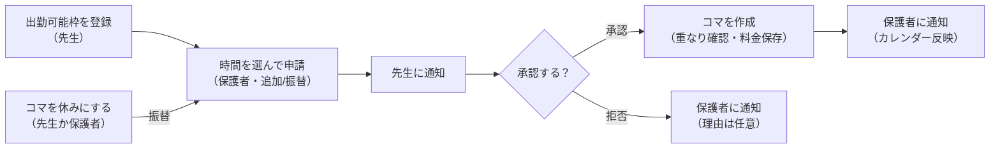

# 家庭教師アプリ 設計書

## 概要

先生と保護者が授業の予定・記録・成績・料金を1つのアプリで共有し、テスト週間の追加コマをスムーズに入れられるようにする。1つのWebアプリ（PWA）をログイン時の役割で「先生用」「保護者用」に出し分ける。

### 利用者

- 先生：1人
- 保護者：生徒2人分（生徒A：月曜1コマ／生徒B：水曜1コマ・金曜2コマ）

### 決定事項

| 項目 | 決めたこと |
| --- | --- |
| 通常コマ | 80分 2,000円（1分25円） |
| テスト対策（追加コマ） | 時給1,500円・30分単位、最低1時間 |
| 追加コマ | 保護者が申請 → 先生に通知 → 承認／拒否 → 保護者に通知 |
| 実施済みの確定 | 予定時刻を過ぎたら自動で「実施済み」 |
| 休み | 先生・保護者どちらからでも設定可。振替を作る |
| 振替の決め方 | 先生の「出勤可能枠」から保護者が選んで申請（追加コマと同じ流れ） |
| 振替の料金 | 1コマ2,000円（通常コマの代わりなので同額）※要確認 |
| 交通費 | なし |
| 契約形態 | 個人契約 |

## 機能一覧

入力は基本的に先生側、閲覧は保護者側。カレンダーとメッセージだけは両方が操作する。

| 機能 | 先生側 | 保護者側 |
| --- | --- | --- |
| 授業記録 | その日の様子・宿題を入力 | 閲覧、新着通知 |
| テスト・模試の結果 | 教科ごとに点数・平均点・偏差値・志望校判定を入力 | 閲覧、推移グラフ |
| メッセージ | 生徒ごとのチャット | 先生とのチャット |
| カレンダー | レギュラーコマの自動表示、休み設定、出勤可能枠の登録 | 休み設定、出勤可能枠の確認 |
| 追加コマ・振替 | 申請を承認／拒否 | 出勤可能枠から時間を選んで申請 |
| テスト週間 | テスト日を入力 | 色分けされた期間を確認 |
| 料金 | 生徒ごと・合計の月収 | その生徒の今月の請求額 |
| 通知 | 申請・休み・メッセージ | 承認結果・記録・休み・メッセージ |

### カレンダーの表示ルール

- 通常コマ：生徒ごとの色
- 休み：グレーアウト＋取り消し線
- 出勤可能枠：破線の枠（空きを示す）
- 申請中：破線＋「承認待ち」バッジ
- 提出物期間（テスト2週間前〜1週間前）：黄色の背景
- 勉強期間（テスト1週間前〜前日）：赤系の背景
- テスト日：太字＋アイコン
- 今日：日付を青い丸で示す（マスの色は付けない。期間の色と混ざらないように）

## 画面一覧

下部タブ4つ（ホーム／カレンダー／記録／メッセージ）を両側で共通にし、中身を役割で切り替える。先生だけ「設定」タブも出す。

| 画面 | 先生側 | 保護者側 |
| --- | --- | --- |
| ログイン | メール＋パスワード | 先生が発行した招待コードで初回登録 |
| ホーム | 今日・今週のコマ、承認待ちの申請、今月の収入合計 | 次回の授業、最新の記録、今月の請求額 |
| カレンダー（月／週） | 全生徒分を表示、枠の登録 | 自分の子の分＋先生の空き枠 |
| 日の詳細 | 休みボタン、記録入力へ | 休みボタン、申請ボタン |
| 出勤可能枠の登録 | 日付・開始・終了（最低1時間） | — |
| 申請（追加／振替） | 承認・拒否（拒否理由は任意） | 枠内で開始・終了を選択、種類を選択 |
| 授業記録 | 様子・宿題の入力、一覧 | 一覧・詳細 |
| テスト・模試 | 結果入力、推移グラフ | 推移グラフ |
| テスト日の登録 | テスト名・開始日・終了日 | — |
| メッセージ | 生徒ごとのチャット一覧 | 先生とのチャット |
| 料金 | 生徒別・合計、月ごとの履歴 | 今月の請求額と内訳 |
| 設定 | 生徒登録、レギュラーコマ、単価 | 通知設定 |

## データ設計（Firestore）

中心は `lessons`（1コマ＝1件）で、休み・振替・料金はすべてここから決まる。

| コレクション | 役割 | 主なフィールド |
| --- | --- | --- |
| users | ログインする人（ドキュメントID＝Auth の UID） | role（teacher / parent）、name、studentIds（今は使っていない。登録時は空配列）、inviteCode（保護者のみ）、fcmTokens（通知を送る端末のトークンの配列） |
| invites | 保護者の招待コード（ドキュメントID＝コード） | used、usedBy、createdAt |
| students | 生徒と契約内容 | name、color、parentUid、regularSlots（曜日・開始・終了の配列）、rates（通常コマ単価・分数、時給、計算単位） |
| lessons | 1コマずつの予定と実績 | studentId、parentUid（students からコピー）、date、start、end、type（regular / extra / makeup）、status（scheduled / cancelled / done）、cancelledBy（teacher / parent）、makeupForId、fee |
| availabilities | 先生の出勤可能枠 | date、start、end |
| requests | 追加コマ・振替の申請 | studentId、parentUid、availabilityId、type（extra / makeup）、date、start、end、makeupForId、status（pending / approved / rejected）、reason、lessonId（承認して作ったコマ）、createdAt |
| records | 授業記録（ドキュメントID＝コマのID。1コマに1つ） | studentId、parentUid（students からコピー）、lessonId、date、condition（様子）、homework |
| exams | テスト日程（色分け用） | studentId、parentUid（students からコピー）、name、startDate、endDate |
| testResults | テスト・模試の結果 | studentId、parentUid（students からコピー）、kind（regular / mock）、name、date、subjects（教科・点数・平均点・偏差値。平均点・偏差値は null 可）、judgements（志望校・判定） |
| chats/{studentId}/messages | メッセージ（生徒ごとのチャット） | senderUid、senderRole（teacher / parent）、text、createdAt、readAt（相手が読んだ時刻。まだなら null） |

### アクセス権限（Security Rules）

- 先生：全データを読み書きできる
- 保護者：parentUid が自分の UID になっているデータ（自分の子の生徒・コマ）だけ読める
- 保護者が書けるのは、申請の作成、自分の子のコマの休み設定、メッセージ送信の3つだけ
  - 休み設定で変えられるのは status と cancelledBy だけ（`diff().affectedKeys().hasOnly()` で確かめる）
  - 予定 → 休み（cancelledBy は parent のみ）と、自分が休みにしたコマの 休み → 予定 だけを許す。先生が休みにしたコマは保護者から戻せない
- 料金（fee）は保護者が書き換えられないようにする
- 先生アカウントはコンソールで手作業で作る。アプリから作れるのは role が parent の users だけにして、だれでも teacher になれる穴を作らない
- 出勤可能枠は、ログインしていればだれでも読める（保護者が空きを見て申請するため）。書けるのは先生だけ
- 申請を作れるのは保護者で、次をすべて満たすときだけ
  - 自分の子についての申請で、parentUid が自分
  - 選んだ枠と同じ日で、枠の時間の中に収まっている
  - 追加コマなら振替元なし。振替なら、振替元が「同じ生徒の、自分の子の、休みにしたコマ」
  - status は pending、reason と lessonId は null、createdAt はサーバーの時刻
- 申請の承認・却下（更新）は先生だけ
- 招待コードは、コードを知っていれば1件だけ読める（登録前の確認用）。一覧は先生だけが取れる
- users の更新で変えられるのは fcmTokens だけ（自分のドキュメントのみ。端末の数は10個まで）。role などを自分で書き換えられないようにする
- 保護者の初回登録では、users の作成と招待コードの使用済み化を同じバッチで書く。Rules の `get`（書き込み前）と `getAfter`（書き込み後）で、2つの書き込みがそろっているかをお互いに確かめる

### 生徒と保護者のつなぎ方

- `users.studentIds`（保護者→生徒）ではなく、`students.parentUid`（生徒→保護者）でつなぐ。先生は生徒の編集画面で保護者を選ぶだけでよく、users を書き換えずに済む
- 同じ parentUid を lessons にもコピーする。Rules はドキュメントを1件ずつではなく「クエリ全体」で判定するので、保護者は `where("parentUid", "==", 自分のUID)` を付けて読む必要がある。コマに parentUid がないと、この条件で絞り込めない
- 生徒の保護者を変えたら、その生徒のコマの parentUid もまとめて書き換える

## ログインと招待コード

### 招待コード

- 先生が発行する。8文字で、紛らわしい `0 O 1 I L` を除いた英大文字と数字（31文字）を使う。約8,500億通り
- 乱数は推測されにくい `crypto.getRandomValues` で作る（`Math.random` は使わない）
- 1回だけ使える。生徒との紐付けは、生徒登録（開発ステップ2）で先生が students.parentUid に保護者を選んで行う

### 保護者の登録の流れ

1. 招待コードを読み、存在していて未使用か確かめる（先にアカウントを作ると、コードが間違っていたときに毎回消す必要があるため）
2. Authentication でアカウントを作る
3. バッチで `users/{uid}`（role: parent）の作成と、`invites/{コード}` の使用済み化を書く
4. 3 が失敗したら、2 で作ったアカウントを削除する（ログインできるのに users がない状態を残さない）

### ログイン状態の管理

- `AuthProvider`（React Context）で、ログイン中のユーザーと users ドキュメント（profile）を全画面に配る
- profile は `getDoc` ではなく `onSnapshot` で読み続ける。登録直後は「users がまだない」という読み込み結果が、作成後の結果より遅れて届き、上書きしてしまうことがあるため。role の変更も再読み込みなしで反映される
- 画面の保護（未ログインなら /login へ移動）はブラウザ側で行う。Firebase のログイン状態はブラウザにしかないため。データは Security Rules で守るので、画面を無理やり表示されても中身は読めない

### 画面を移動したときの状態

- next.config.ts の `cacheComponents: true` により、一度開いた画面は閉じずに隠して残る（React の `<Activity>`）。戻ったときに入力中の値や「保存中…」がそのまま残る
- 対策
  - 送信中の表示（submitting）は、成功しても失敗しても `finally` で必ず戻す
  - 新規登録フォームは、保存後に `key` を変えて作り直し、空の状態に戻す
  - ログイン・登録の成功後はパスワード欄を空にする
  - ログアウトは `window.location.href` でページごと読み込み直し、前の人の画面を残さない
  - 編集画面は、読み込んだデータを「どの id のものか」と一緒に持ち、フォームに `key={id}` を付ける。別のデータを開いたときに、前のデータの入力が残らないようにするため
  - 読み込んだときにデータがなければ、入力欄を空に戻す（授業記録：記録のないコマを開いたとき）

### 数値の入力欄

- 単価などは `type="number"` ではなく `type="text"` ＋ `inputMode="numeric"` にし、入力中は文字列で持つ。`Number("")` が 0 になって空欄にできない問題と、日本語入力（全角数字）が入らない問題を避けるため
- 全角数字の半角化と数字以外の除去は、欄から離れたとき（onBlur）と保存時に行う。入力の途中で値を書き換えると、日本語入力の表示が崩れるため

## 主要ロジック

### 1. レギュラーコマの自動生成

- 生徒を保存したら（新規・編集とも）、今日から3か月先までの lessons を作る
- ドキュメントIDを「studentId_日付_開始時刻」（例：`abc123_2026-11-16_1700`）にして、二重に作らない
- すでにあるコマは上書きしない（休みや振替の設定を消さないため）
- 曜日や時間を変えて合わなくなった「未来の・予定のままの・通常コマ」は削除する。過去のコマ、休みにしたコマ、追加コマ・振替は残す
- 作成・削除・parentUid の書き換えは1つのバッチでまとめて書く
- 既存コマの読み込みは `where("studentId", "==", id)` だけにし、複合インデックスを作らずに済むようにする
- 作る日付を計算する部分（`generateRegularLessons`）は Firestore を使わない関数に分け、読み書き（`syncRegularLessons`）と切り離す
- 毎月1日に1か月分を足す処理は、Cloud Functions（Blazeプラン）が必要なので Issue #10 に回す。それまでは生徒を保存し直せば3か月先まで足される

### 2. 実施済みの自動判定

- status が scheduled で終了時刻を過ぎたコマを done にする
- 最初は「表示するときに判定する」だけでOK。後で定期実行の関数に移す
- 今は `displayStatus(コマ, 今)` で表示するときに判定し、Firestore の status は書き換えない。終了日時（`日付T終了時刻`）と今を `"2026-11-19T18:20"` の形の文字列にそろえて、`<=` で比べる。定期実行で status を書き換える処理は、Cloud Functions が必要なので Issue #10 に回す
- 日の詳細画面でも、終わったコマは「実施済み」と表示し、「休みにする」ボタンを出さない
- 「今」は `useState(() => new Date())` で画面を開いたときに1回だけ取る。描画の途中で `new Date()` や `Date.now()` を呼ぶと、描くたびに値が変わってしまう（React の lint もエラーにする）

### 3. テスト週間の色分け

テスト初日を D として、保存せずに表示時に計算する。

| 期間 | 範囲 | 色 |
| --- | --- | --- |
| 提出物期間 | D−14日 〜 D−8日 | 黄色 |
| 勉強期間 | D−7日 〜 D−1日 | 赤系 |
| テスト期間 | D 〜 最終日 | 太字＋アイコン |

- **登録**：先生が生徒の編集画面の「テスト日程」で、テスト名・初日・最終日を登録・削除する（生徒ごと。学校が違えばテストの日も違うため）。追加・削除はその場で保存する
- **parentUid**：lessons と同じく students からコピーし、保護者は `where("parentUid", "==", 自分のUID)` で読む。生徒の保護者を変えたら、その生徒のテストの parentUid もまとめて書き換える（`syncExamParent`）
- **期間の計算**：`examPeriods(初日)` が、提出物期間と勉強期間の始まりと終わりを返す（Firestore を使わない関数）。日付の足し引きは `addDays`（`Date.setDate` を使うので、月をまたいでも正しく計算できる）
- **期間が重なったとき**：生徒が2人いて期間が重なると、黄と赤が混ざってオレンジになってしまう。そこで、日付ごとに1つの期間に決めてから塗る。重なったら勉強期間を優先する（テストに近いため）
- **カレンダーでの塗り方**（FullCalendar v7 で確かめたこと）
  - 期間の色は背景の予定（`display: "background"`）で付ける。classic テーマは指定した色を15%だけ混ぜて塗るので、濃い色（黄 `#eab308`、赤 `#ef4444`）を指定する
  - 時刻付きの背景予定は月表示に出ず、終日の背景予定は週表示だと終日の欄にしか出ない。そこで1日につき両方を作る
  - `end` はその日を含まないので、翌日を指定する
- **今日の表示**：今日のマスの色（標準では薄い黄色）は、提出物期間の黄色と混ざって見分けにくい。そこで、マスの色は消して（`--fc-classic-today` を透明に上書き）、日付を青い丸で示す
- テスト期間は「📝 テスト名（生徒名）」の太字の終日予定にする。週表示でも見えるように、終日の欄（`allDaySlot`）を出す

### 4. 料金計算

- 通常コマ・振替：1コマ2,000円
- 追加コマ（テスト対策）：fee = 1500 × 分数 / 60（分数は60, 90, 120…の30分単位）
  - 例：1時間30分なら2,250円、2時間なら3,000円
- 休みにしたコマは0円。ただし fee は書き換えず、料金を計算するときに cancelled のコマを数えないことで0円にする（保護者が fee に触らずに済み、休みを取り消せば元の金額に戻る）
- 月の請求額＝その月の done のコマの fee の合計。これからの予定分は「見込み」として別に表示
- fee はコマを作った時点で保存し、単価を変えても過去の金額が変わらないようにする
  - レギュラーコマ：生成するときに通常コマの料金（`rates.regularFee`）
  - 振替：承認するときに通常コマの料金
  - 追加コマ：承認するときに 時給 × 分 ÷ 60（四捨五入）。30分単位・最低1時間は申請フォームで決まる
- 月の集計は `summarizeMonth(コマ, "2026-11", 今)` にまとめる（Firestore を使わない関数）。その月の休み以外のコマを、実施済みなら「確定」、まだなら「見込み」に足す
- **先生のホーム**：今月の収入（合計・生徒別の確定と見込み）。今月のコマだけを `where("date", ">=", "2026-11-01")` と `where("date", "<=", "2026-11-31")` で読む（1つのフィールドの範囲なので複合インデックスは不要。文字列の比較なので、11月に31日がなくても問題ない）
- **月ごとの履歴**（`/settings/income`）：今月から12か月前まで、月ごとの確定額と生徒別の内訳。設定の下に置き、先生だけのガードをそのまま使う
- **保護者のホーム**：今月の請求額（合計・確定・見込み）と内訳（日付・時刻・生徒・種類・金額・実施済みか）
  - 保護者のクエリは `where("parentUid", "==", 自分のUID)` が必須。ここに日付の範囲も足すと複合インデックスが必要になるので、parentUid だけで読み、今月の分は `summarizeMonth` の中で絞る

### 5. 申請から確定まで

承認時に「他のコマと時間が重なっていないか」を確認し、申請の更新とコマの作成をトランザクションでまとめて行う（2人が同じ枠を同時に申請しても壊れない）。

- **出勤可能枠**：先生が日の詳細画面で登録・削除する。最低1時間（画面側で確認）。承認したあとも枠は残す（1つの枠から複数の申請が通ることがあるため。重なりは承認時に防ぐ）
- **申請**：保護者が日の詳細画面で枠を選び、生徒・種類・時間を選ぶ。時間は枠の中から30分刻みで、最低1時間
- **振替元の候補**：自分の子の休みにしたコマのうち、振替のコマがまだなく、承認待ち・承認済みの振替申請もないもの（却下された申請の振替元は、もう一度選べる）
- **表示**：承認待ちの申請は、カレンダーに黄色の破線、日の詳細画面に「承認待ち」のバッジで出す。保護者のホームには、申請の結果（理由つき）を新しい順に出す
- **承認の手順**（`approveRequest`）
  1. 生徒を読む（料金と parentUid のため）
  2. その日のコマをクエリで読み、休み以外のコマと時間が重なっていないか確かめる（A の開始 < B の終了、かつ B の開始 < A の終了）。振替なら、同じ振替元のコマがもうないかも確かめる
  3. 料金を決める。追加コマは 時給 × 分 ÷ 60（四捨五入）、振替は通常コマの料金
  4. トランザクションで「申請がまだ pending か」「同じIDのコマがないか」を確かめ、コマの作成と申請の承認（lessonId の保存）を同時に書く
- **2 をトランザクションの外にした理由**：ブラウザ用の Firestore SDK のトランザクションでは、クエリが使えない（1件ずつの get だけ）。承認するのは先生1人なので、直前のクエリで確かめれば十分。二重承認はトランザクション内の status の確認で防ぐ
- **却下**：理由は任意。`window.prompt` はブラウザによって使えないので、画面の中に入力欄を出す
- **通知**は Issue #9 でまとめて作る

### 6. 休みの設定と取り消し

- カレンダーの日付かコマを押すと、日の詳細画面（`/calendar/2026-11-20`）に移る。その日のコマを `where("date", "==", 日付)` で読む（保護者は parentUid との2条件。どちらも `==` なので複合インデックスは不要）
- 休みにすると status を cancelled にし、cancelledBy にだれが休みにしたか（teacher / parent）を入れる。保護者は1家庭なので、UID ではなく役割で足りる
- 取り消すと status を scheduled、cancelledBy を null に戻す
- ボタンを出す条件
  - 休みにする：予定のコマで、日付が今日以降（過去のコマは休みにできない。ルールでは日付を比べず、画面側だけで制限する）
  - 取り消す：休みのコマで、先生が見ているか、保護者が休みにしたコマ
- 休みにするときは確認ダイアログを出す
- カレンダーでは、休みのコマをグレー＋薄く＋取り消し線で表示する（FullCalendar の予定に `color` と `className` を渡す）
- 振替は Issue #4（申請と承認）でまとめて作る

### 7. 授業記録とテスト結果

- **授業記録**：先生が、日の詳細画面で実施済みのコマの「記録を書く」から、様子と宿題を書く。ドキュメントIDをコマのIDにして `setDoc` で保存するので、1コマに記録は1つ（2回目からは編集になる）。Rules でも `lessonId == ドキュメントID` を確かめる
- **テスト結果**：先生が「記録」タブの「結果を追加」から入力する。種類（定期テスト／模試）、テスト名、日付、教科ごとの結果（点数は必須、平均点・偏差値は空なら null）、志望校判定。追加・編集・削除ができる。追加と編集は同じフォームの部品（`TestResultForm`）を使う
  - 数字の欄は `type="text"` ＋ `inputMode="decimal"` にして入力中は文字列で持ち、保存のときに数値にする。空欄の点数は NaN にして、数字でない入力と一緒にエラーにする（`Number("")` は 0 になってしまうため）
  - 配列の中身（点数が数字かなど）は Rules では確かめられない（繰り返しが書けない）ので、フォーム側で確かめる。Rules では配列の件数だけ確かめる
- **「記録」タブ**（`/records`）：生徒を選び、授業記録（新しい順）、テスト結果、推移グラフを並べる。保護者は同じ画面を見るだけで使う（編集・削除・追加のボタンは出さない）
  - 先生は全部、保護者は parentUid が自分のものを1回だけ読み、選んだ生徒の分はアプリの中で絞る（生徒を切り替えるたびに読み直さないため）
- **推移グラフ**（Recharts 3.10.1）：教科を選び、「点数（＋平均点の破線）」と「偏差値」を切り替える。偏差値のない回は飛ばして線をつなぐ（`connectNulls`）。グラフに `responsive` を付けて、画面の幅に合わせる（`ResponsiveContainer` は不要）
- 生徒の保護者を変えたら、テスト日程・授業記録・テスト結果の parentUid をまとめて書き換える（`syncStudentParent`）

### 8. メッセージ

- 生徒ごとのチャット（`chats/{生徒のID}/messages`）。先生とその生徒の保護者がやり取りする。兄弟がいる家庭では生徒ごとに分かれる
- **Rules**：パスの `{studentId}` から生徒を `get` で読み、その生徒の parentUid が自分かを確かめる。パスの値はクエリのときも決まっているので、一覧で読むときもこの確かめ方が使える（そのため、メッセージには parentUid をコピーしない）
  - 送信：senderUid が自分、senderRole が自分の役割、本文1〜1000文字、createdAt はサーバーの時刻、readAt は null
  - 既読：相手が送った、readAt が null のメッセージの readAt だけを、サーバーの時刻にできる
  - 削除はだれもできない
- **チャット画面**（`/messages/[生徒のID]`）：`orderBy("createdAt")` で古い順に読み続ける（リアルタイム）。送った直後は createdAt が null なので、`data({ serverTimestamps: "estimate" })` で手元の見積もり時刻を使う
- **既読**：チャット画面でメッセージが届くたびに、相手から来た未読のメッセージの readAt をバッチでまとめて書く。自分のメッセージの下に、readAt があれば「既読」と出す。画面が `cacheComponents` で隠れている間は useEffect が止まるので、勝手に既読にならない
- **一覧**（`/messages`、下部タブの「メッセージ」）：生徒ごとに、最後のメッセージ（`orderBy("createdAt", "desc")` ＋ `limit(1)`）と未読の数（`where("senderRole", "==", 相手)` ＋ `where("readAt", "==", null)` の件数）を出す。どちらも複合インデックスは不要。先生の一覧には、保護者が登録されている生徒だけを出す
- `orderBy` や `where` のフィールド名は文字列なので、型チェックでは間違いが見つからない。`orderBy` に書いたフィールドを持たないドキュメントは結果に出てこないので、打ち間違えると何も表示されない
- 新しいメッセージの通知は「9. プッシュ通知と PWA」を参照

### 9. プッシュ通知と PWA

- **PWA**：`app/manifest.ts`（名前・アイコン・`display: "standalone"`）とアイコン（192・512・apple-icon）を置く。iPhone は「ホーム画面に追加」したときだけ Web の通知を使えるため
- **トークンの保存**（`lib/notifications.ts`）：通知の許可をもらい、`/sw.js` を登録して、`navigator.serviceWorker.ready` を待ってから `getToken` する（待たないと Safari で止まる）。トークンは `users.fcmTokens` に `arrayUnion` で足す。1人が複数の端末を使えるように配列にする
  - 「許可しますか？」は、まだ許可されていないときだけ聞く。Safari はボタンを押したとき以外に聞くと、許可済みでも「許可されていない」と返すため
  - 許可済みの端末では、ホームを開くたびにトークンを保存し直す（トークンが変わることがあるため）
- **送る側**（`functions/src/index.ts`、Cloud Functions v2、東京リージョン）：Firestore の書き込みをきっかけに動く
  | きっかけ | 送る相手 | 押したときに開く画面 |
  | --- | --- | --- |
  | 申請が作られた | 先生 | ホーム |
  | 申請が承認・却下された（pending から変わったときだけ） | 申請した保護者 | 承認：その日のカレンダー／却下：ホーム |
  | コマが予定 → 休みになった | 休みにしなかった方 | その日のカレンダー |
  | メッセージが届いた | 相手 | そのチャット |
  - 使えなくなったトークン（アプリを消した端末など）は、送ったときのエラーで見つけて fcmTokens から消す
- **表示する側**（`public/sw.js`）：Functions からは `data`（title・body・link）だけを送り、表示は Service Worker が決める
  - そのチャットを画面に出している（`visibilityState === "visible"`）ときは通知を出さない。`focused` だと別のアプリを触っている間に false になるので使わない
  - Safari は「届いたら必ず通知を表示する」決まりがあるので、音なしで出してすぐ消す。それでも一瞬見えることがあるが、許可を外されないことを優先して受け入れる
  - 新しい sw.js はすぐ入れ替える（`skipWaiting` ＋ `clients.claim`）。古いものが残ると、直した動きが反映されない
- **Blaze プラン**：Cloud Functions に必要。この規模なら無料枠に収まるが、念のため予算アラートを設定した
- **公開**：Vercel。ブランチを push するとプレビューができるので、iPhone での確認はプレビューの URL で行う。環境変数は Production・Preview・Development の全部に入れる
- 確かめ方の注意：Chrome のシークレットウィンドウでは通知は必ず拒否される。開発者ツールの Service Workers で「Offline」にチェックが入っていると、新しい sw.js が待ったままになる

## 技術構成

| 用途 | 使うもの |
| --- | --- |
| 画面 | Next.js、TypeScript、Tailwind CSS |
| ログイン | Firebase Authentication |
| データ | Cloud Firestore |
| カレンダー表示 | FullCalendar |
| グラフ | Recharts |
| 通知 | Firebase Cloud Messaging（iPhoneはホーム画面に追加した場合のみ） |
| 定期処理・通知送信 | Cloud Functions（Blazeプランが必要だが、この規模なら無料枠内） |
| 公開 | Vercel |

## 開発ステップ

- [x] 1. 環境構築とログイン（先生／保護者の役割分け、招待コード）
- [x] 2. 生徒登録とレギュラーコマの自動生成、カレンダー表示
- [x] 3. 休みの設定と表示
- [x] 4. 出勤可能枠、申請、承認／拒否（追加コマ・振替）
- [x] 5. テスト日程の登録と色分け
- [x] 6. 料金計算（生徒別・合計・保護者の請求額）
- [x] 7. 授業記録、テスト結果の入力と推移グラフ
- [x] 8. メッセージ
- [x] 9. プッシュ通知とPWA化
- [ ] 10. 保護者に実際に使ってもらい、感想をもらって直す

## 進め方のルール（Claude Code向け）

- これはポートフォリオなので、開発者（Yamato）が自分で理解しながら実装する
- 一度に全部作らず、上の開発ステップを1つずつ進める
- コードを書く前に、何をどう作るかを短く説明する
- 設計の判断（なぜその方法にしたか）はコメントかこのファイルに残す
