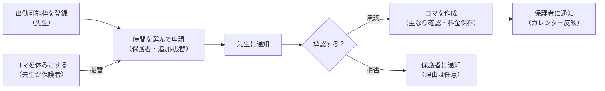

# 家庭教師アプリ 設計書

## 概要

先生と保護者が授業の予定・記録・成績・料金を1つのアプリで共有し、テスト週間の追加コマをスムーズに入れられるようにする。1つのWebアプリ（PWA）をログイン時の役割で「先生用」「保護者用」に出し分ける。

### 利用者

- 先生：1人
- 保護者：生徒2人分（生徒A：月曜1コマ／生徒B：水曜1コマ・金曜2コマ）

### 決定事項

| 項目 | 決めたこと |
| --- | --- |
| 通常コマ | 80分 2,000円（1分25円） |
| テスト対策（追加コマ） | 時給1,500円・30分単位、最低1時間 |
| 追加コマ | 保護者が申請 → 先生に通知 → 承認／拒否 → 保護者に通知 |
| 実施済みの確定 | 予定時刻を過ぎたら自動で「実施済み」 |
| 休み | 先生・保護者どちらからでも設定可。振替を作る |
| 振替の決め方 | 先生の「出勤可能枠」から保護者が選んで申請（追加コマと同じ流れ） |
| 振替の料金 | 1コマ2,000円（通常コマの代わりなので同額）※要確認 |
| 交通費 | なし |
| 契約形態 | 個人契約 |

## 機能一覧

入力は基本的に先生側、閲覧は保護者側。カレンダーとメッセージだけは両方が操作する。

| 機能 | 先生側 | 保護者側 |
| --- | --- | --- |
| 授業記録 | その日の様子・宿題を入力 | 閲覧、新着通知 |
| テスト・模試の結果 | 教科ごとに点数・平均点・偏差値・志望校判定を入力 | 閲覧、推移グラフ |
| メッセージ | 生徒ごとのチャット | 先生とのチャット |
| カレンダー | レギュラーコマの自動表示、休み設定、出勤可能枠の登録 | 休み設定、出勤可能枠の確認 |
| 追加コマ・振替 | 申請を承認／拒否 | 出勤可能枠から時間を選んで申請 |
| テスト週間 | テスト日を入力 | 色分けされた期間を確認 |
| 料金 | 生徒ごと・合計の月収 | その生徒の今月の請求額 |
| 通知 | 申請・休み・メッセージ | 承認結果・記録・休み・メッセージ |

### カレンダーの表示ルール

- 通常コマ：生徒ごとの色
- 休み：グレーアウト＋取り消し線
- 出勤可能枠：破線の枠（空きを示す）
- 申請中：破線＋「承認待ち」バッジ
- 提出物期間（テスト2週間前〜1週間前）：黄色の背景
- 勉強期間（テスト1週間前〜前日）：赤系の背景
- テスト日：太字＋アイコン

## 画面一覧

下部タブ4つ（ホーム／カレンダー／記録／メッセージ）を両側で共通にし、中身を役割で切り替える。

| 画面 | 先生側 | 保護者側 |
| --- | --- | --- |
| ログイン | メール＋パスワード | 先生が発行した招待コードで初回登録 |
| ホーム | 今日・今週のコマ、承認待ちの申請、今月の収入合計 | 次回の授業、最新の記録、今月の請求額 |
| カレンダー（月／週） | 全生徒分を表示、枠の登録 | 自分の子の分＋先生の空き枠 |
| 日の詳細 | 休みボタン、記録入力へ | 休みボタン、申請ボタン |
| 出勤可能枠の登録 | 日付・開始・終了（最低1時間） | — |
| 申請（追加／振替） | 承認・拒否（拒否理由は任意） | 枠内で開始・終了を選択、種類を選択 |
| 授業記録 | 様子・宿題の入力、一覧 | 一覧・詳細 |
| テスト・模試 | 結果入力、推移グラフ | 推移グラフ |
| テスト日の登録 | テスト名・開始日・終了日 | — |
| メッセージ | 生徒ごとのチャット一覧 | 先生とのチャット |
| 料金 | 生徒別・合計、月ごとの履歴 | 今月の請求額と内訳 |
| 設定 | 生徒登録、レギュラーコマ、単価 | 通知設定 |

## データ設計（Firestore）

中心は `lessons`（1コマ＝1件）で、休み・振替・料金はすべてここから決まる。

| コレクション | 役割 | 主なフィールド |
| --- | --- | --- |
| users | ログインする人（ドキュメントID＝Auth の UID） | role（teacher / parent）、name、studentIds、inviteCode（保護者のみ）、fcmToken |
| invites | 保護者の招待コード（ドキュメントID＝コード） | used、usedBy、createdAt |
| students | 生徒と契約内容 | name、color、parentUid、regularSlots（曜日・開始・終了の配列）、rates（通常コマ単価・分数、時給、計算単位） |
| lessons | 1コマずつの予定と実績 | studentId、date、start、end、type（regular / extra / makeup）、status（scheduled / cancelled / done）、cancelledBy、makeupForId、fee |
| availabilities | 先生の出勤可能枠 | date、start、end |
| requests | 追加コマ・振替の申請 | studentId、availabilityId、type（extra / makeup）、start、end、makeupForId、status（pending / approved / rejected）、reason |
| records | 授業記録 | studentId、lessonId、date、condition（様子）、homework |
| exams | テスト日程（色分け用） | studentId、name、startDate、endDate |
| testResults | テスト・模試の結果 | studentId、kind（定期テスト / 模試）、name、date、subjects（教科・点数・平均点・偏差値）、judgements（志望校・判定） |
| chats/{studentId}/messages | メッセージ | senderUid、text、createdAt、readAt |

### アクセス権限（Security Rules）

- 先生：全データを読み書きできる
- 保護者：自分の子の studentId を持つデータだけ読める
- 保護者が書けるのは、申請の作成、自分の子のコマの休み設定、メッセージ送信の3つだけ
- 料金（fee）は保護者が書き換えられないようにする
- 先生アカウントはコンソールで手作業で作る。アプリから作れるのは role が parent の users だけにして、だれでも teacher になれる穴を作らない
- 招待コードは、コードを知っていれば1件だけ読める（登録前の確認用）。一覧は先生だけが取れる
- 保護者の初回登録では、users の作成と招待コードの使用済み化を同じバッチで書く。Rules の `get`（書き込み前）と `getAfter`（書き込み後）で、2つの書き込みがそろっているかをお互いに確かめる

## ログインと招待コード

### 招待コード

- 先生が発行する。8文字で、紛らわしい `0 O 1 I L` を除いた英大文字と数字（31文字）を使う。約8,500億通り
- 乱数は推測されにくい `crypto.getRandomValues` で作る（`Math.random` は使わない）
- 1回だけ使える。生徒との紐付け（studentIds）は、生徒登録（開発ステップ2）で先生が行う

### 保護者の登録の流れ

1. 招待コードを読み、存在していて未使用か確かめる（先にアカウントを作ると、コードが間違っていたときに毎回消す必要があるため）
2. Authentication でアカウントを作る
3. バッチで `users/{uid}`（role: parent）の作成と、`invites/{コード}` の使用済み化を書く
4. 3 が失敗したら、2 で作ったアカウントを削除する（ログインできるのに users がない状態を残さない）

### ログイン状態の管理

- `AuthProvider`（React Context）で、ログイン中のユーザーと users ドキュメント（profile）を全画面に配る
- profile は `getDoc` ではなく `onSnapshot` で読み続ける。登録直後は「users がまだない」という読み込み結果が、作成後の結果より遅れて届き、上書きしてしまうことがあるため。role の変更も再読み込みなしで反映される
- 画面の保護（未ログインなら /login へ移動）はブラウザ側で行う。Firebase のログイン状態はブラウザにしかないため。データは Security Rules で守るので、画面を無理やり表示されても中身は読めない

## 主要ロジック

### 1. レギュラーコマの自動生成

- 生徒の regularSlots を保存したら、3か月先までの lessons を作る
- 毎月1日に、空いた1か月分を足す
- ドキュメントIDを「studentId_日付_開始時刻」にして、二重に作らない

### 2. 実施済みの自動判定

- status が scheduled で終了時刻を過ぎたコマを done にする
- 最初は「表示するときに判定する」だけでOK。後で定期実行の関数に移す

### 3. テスト週間の色分け

テスト初日を D として、保存せずに表示時に計算する。

| 期間 | 範囲 | 色 |
| --- | --- | --- |
| 提出物期間 | D−14日 〜 D−8日 | 黄色 |
| 勉強期間 | D−7日 〜 D−1日 | 赤系 |
| テスト期間 | D 〜 最終日 | 太字＋アイコン |

### 4. 料金計算

- 通常コマ・振替：1コマ2,000円
- 追加コマ（テスト対策）：fee = 1500 × 分数 / 60（分数は60, 90, 120…の30分単位）
  - 例：1時間30分なら2,250円、2時間なら3,000円
- 休みにしたコマは0円
- 月の請求額＝その月の done のコマの fee の合計。これからの予定分は「見込み」として別に表示
- fee はコマを作った時点で保存し、単価を変えても過去の金額が変わらないようにする

### 5. 申請から確定まで

承認時に「他のコマと時間が重なっていないか」を確認し、申請の更新とコマの作成をトランザクションでまとめて行う（2人が同じ枠を同時に申請しても壊れない）。

## 技術構成

| 用途 | 使うもの |
| --- | --- |
| 画面 | Next.js、TypeScript、Tailwind CSS |
| ログイン | Firebase Authentication |
| データ | Cloud Firestore |
| カレンダー表示 | FullCalendar |
| グラフ | Recharts |
| 通知 | Firebase Cloud Messaging（iPhoneはホーム画面に追加した場合のみ） |
| 定期処理・通知送信 | Cloud Functions（Blazeプランが必要だが、この規模なら無料枠内） |
| 公開 | Vercel または Firebase Hosting |

## 開発ステップ

- [ ] 1. 環境構築とログイン（先生／保護者の役割分け、招待コード）
- [ ] 2. 生徒登録とレギュラーコマの自動生成、カレンダー表示
- [ ] 3. 休みの設定と表示
- [ ] 4. 出勤可能枠、申請、承認／拒否（追加コマ・振替）
- [ ] 5. テスト日程の登録と色分け
- [ ] 6. 料金計算（生徒別・合計・保護者の請求額）
- [ ] 7. 授業記録、テスト結果の入力と推移グラフ
- [ ] 8. メッセージ
- [ ] 9. プッシュ通知とPWA化
- [ ] 10. 保護者に実際に使ってもらい、感想をもらって直す

## 進め方のルール（Claude Code向け）

- これはポートフォリオなので、開発者（Yamato）が自分で理解しながら実装する
- 一度に全部作らず、上の開発ステップを1つずつ進める
- コードを書く前に、何をどう作るかを短く説明する
- 設計の判断（なぜその方法にしたか）はコメントかこのファイルに残す
